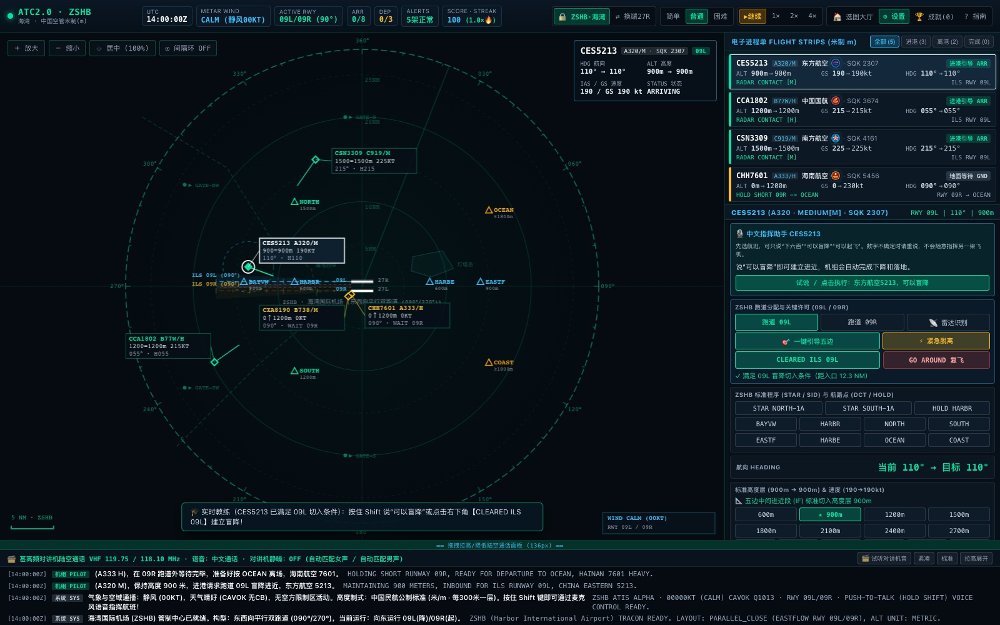

# 空中交通管制模拟器 ATC2.0

大家好，我是 BIG JIANG。这个空管小游戏从 1.0 慢慢做到了 2.0，很高兴终于能把新的版本分享给大家。

平时我们更多是在模拟飞行里当机长，这次想请大家换个位置，坐到雷达屏幕前，当一回空中交通管制员：调整航向、高度和速度，安排飞机进近、起飞、落地和移交，让一片空域慢慢变得井然有序。

**[打开官网](https://bigjiang001.github.io/ATC-Simulator/) · [直接开始游戏](https://bigjiang001.github.io/ATC-Simulator/game/) · [反馈问题或建议](https://github.com/Bigjiang001/ATC-Simulator/issues)**



## 2.0 可以玩什么

- **四座机场**：海湾、上海浦东、东京羽田和伦敦希思罗，体验不同跑道布局与运行态势。
- **自由选择难度**：简单、普通、困难；第一次接触可以先选新手教学，跟着指引完成游戏内考证。
- **电子进程单与雷达指挥**：查看航班、高度、速度、航向和进离港状态，用按钮、拖拽或文字发出指令。
- **标准进离场程序**：STAR、SID、航路点直飞、空中等待、ILS 进近，以及起飞、复飞和离场移交。
- **语音陆空通话**：按住 Shift 说话，松开发送；机组先复诵指令，最后报告航班号，底部保留中英文通话记录。
- **更丰富的运行细节**：跑道占用、尾流间隔、天气和特情。先从简单模式体验，再慢慢增加挑战。

五关闯关目前暂不开放，后续希望和大家一起把关卡、机场与成长机制设计得更有意思。

这是一个用于娱乐和航空交流的模拟小游戏，仍有简化与不完善的地方，不用于真实管制训练。

## 两种体验方式

| | 在线版 | 本地模型版 |
| --- | --- | --- |
| 适合谁 | 想打开网页先玩一会儿 | 想体验更多音色、研究或修改模型 |
| 位置 | [在线游玩](https://bigjiang001.github.io/ATC-Simulator/game/)；源码在 `online/` | 代码与启动器在 `local/` |
| 语音播报 | 浏览器和系统提供的声音，管制员优先女声、飞行员优先男声 | 本机运行中文、英文语音合成模型，可选音色和语速 |
| 语音识别 | 浏览器语音识别接口 | 本机 SenseVoice Small |
| 安装 | 无需安装游戏模型 | 首次启动安装独立环境并下载模型 |

在线版推荐最新版 Chrome。各浏览器、系统和网络环境提供的声音及识别能力不同，浏览器识别可能把音频发送到厂商服务，不能保证离线可用。无法使用麦克风时，仍然可以通过文字和按钮玩。项目没有为在线版接入收费语音 API。

## 想在自己电脑上部署

1. 在仓库右上方选择 **Code → Download ZIP**，或者克隆整个仓库。
2. 完整解压，进入 **`local/` 文件夹**。
3. Mac 双击 `ATC_Launcher_macOS.command`；Windows 11 双击 `ATC_Launcher_Windows11.bat`。它们在同一个源码包里，无需分别下载平台包。
4. 第一次保持联网，等待安装环境、下载并加载模型；服务就绪后会自动打开游戏页面。游戏期间请保持启动器窗口打开。

不用事先准备编程环境，也不需要为玩本地模型版安装 Node.js。首次下载可能花一些时间，模型和环境都保存在本机；下载中断后可以重新启动。不同电脑的生成速度会有差异。Windows 全新电脑与 Intel Mac 的首次安装仍欢迎大家帮忙反馈。

**仓库不包含模型权重、虚拟环境或开发者个人配置。** 更详细的步骤见 [本地部署指南](docs/LOCAL_SETUP.md)。

## 我目前使用的本地语音模型

如果你也喜欢折腾声音，可以先从已经接好的这套组合开始：

| 模型 | 在游戏里的用途 | 官方来源 |
| --- | --- | --- |
| Qwen3-TTS-12Hz-0.6B-CustomVoice | 中文播报，也可选择它的外语音色 | [模型页面](https://huggingface.co/Qwen/Qwen3-TTS-12Hz-0.6B-CustomVoice) |
| Kokoro-82M | 默认英文播报 | [模型页面](https://huggingface.co/hexgrad/Kokoro-82M)、[ONNX 运行库](https://github.com/thewh1teagle/kokoro-onnx) |
| SenseVoice Small | 识别玩家说出的指令，不负责播报 | [模型页面](https://huggingface.co/FunAudioLLM/SenseVoiceSmall) |

Apple Silicon 上，启动器会选用同一 Qwen 0.6B 模型的 [MLX 8-bit 版本](https://huggingface.co/mlx-community/Qwen3-TTS-12Hz-0.6B-CustomVoice-8bit)。

Qwen 当前可选择 Vivian、Serena、Uncle_Fu 等普通话音色，也有 Dylan（北京话）、Eric（四川成都话）及 Ryan、Aiden 等外语音色。Kokoro 已接入 Adam、Michael、Bella、Heart、George、Emma 六种英文音色。可以先在游戏设置里试听，再给管制员和机组选声音，让每次执勤多一点趣味。

也欢迎大家接入自己喜欢的模型。换模型通常需要适配接口、音色配置和发音规则，并不是把任意权重放进文件夹就能直接使用。相关位置和注意事项见 [语音模型与扩展](docs/VOICE_MODELS.md)。各模型和第三方依赖沿用各自许可，感谢它们的作者与社区。

## 欢迎一起来做

这个小游戏还有很多可以改进的地方。如果你玩的时候遇到问题，或者想到更有意思的玩法、机场、关卡和升级方向，都欢迎告诉我。说得不够专业的地方，也请大家多多指正。

如果你是航空爱好者、管制员、飞行员，或者熟悉程序、语音和界面设计的朋友，非常欢迎一起参与。无论是帮忙核对一句陆空通话、调整一条进离场程序、完善新手教学，还是提交代码和新的机场设计，都是对这个小项目很大的帮助。

我希望它能成为一个大家都能参与的小地方：把经验分享出来，把想法慢慢做出来，一起学习，也一起把这个空管小游戏做得更好。

- 反馈与讨论：[GitHub Issues](https://github.com/Bigjiang001/ATC-Simulator/issues)
- 代码贡献：欢迎 Fork 后提交 Pull Request，入门说明见 [CONTRIBUTING.md](CONTRIBUTING.md)
- 联系 QQ：**351166690**（可以备注“空管小游戏”）

谢谢你愿意来玩，也谢谢每一位愿意提出建议、帮忙测试和参与开发的朋友。

## 开发与网站部署

```sh
npm ci
npm test
npm run typecheck
npm run build
npm run preview
```

网站素材和介绍在 `website/`，浏览器游戏源码在 `online/`，本地模型版在 `local/`。构建产物为 `dist/`；主分支通过测试后由 GitHub Actions 发布到 Pages。旧的 `game.html` 和 `game-page.html` 链接会转到 2.0 游戏，1.0 程序撤下，历史仍可在 Git 记录中查看，官网保留一条旧版截图回顾。

项目代码采用 [MIT License](LICENSE)，模型、依赖及第三方素材按各自许可使用。

由 **BIG JIANG STUDIO** 设计开发。

## 网站访问分析与管理员统计

Mac 用户双击根目录的 `打开统计面板.command`，自动验证本机身份，查看访问量、实时游戏玩家、有效游玩时长及趋势图。当前使用 Firebase Spark 免费方案，无需绑定银行卡；玩家无需注册。本机服务仅返回汇总，原始玩家记录不会发送到面板浏览器。

首页、游戏 UI 与 GitHub Pages 路径保持不变。公开生产配置已接入构建流程，每次发布自动保留统计。完整指标口径、Google Analytics / Firebase 后台步骤、权限与免费额度边界见[配置说明](docs/analytics.md)。
